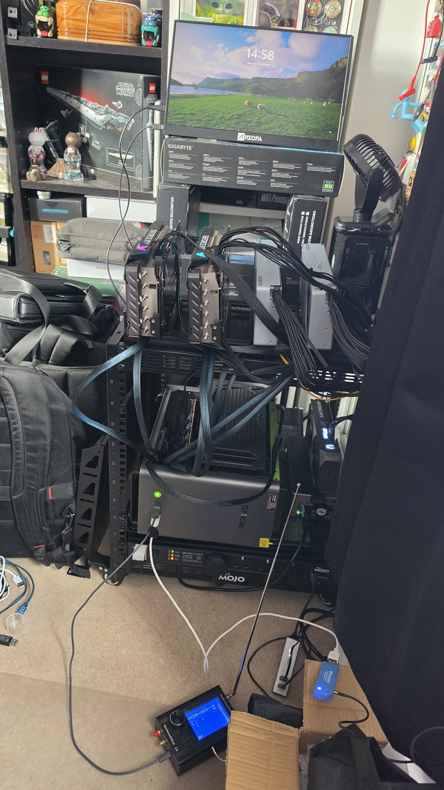
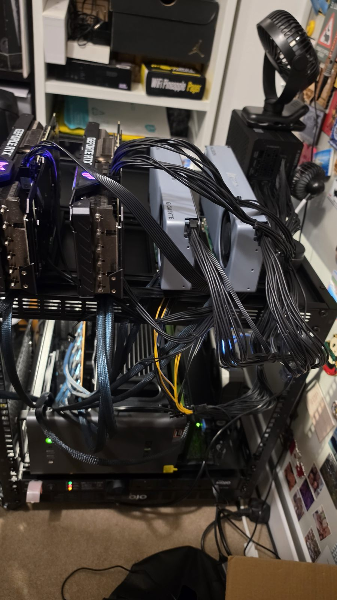
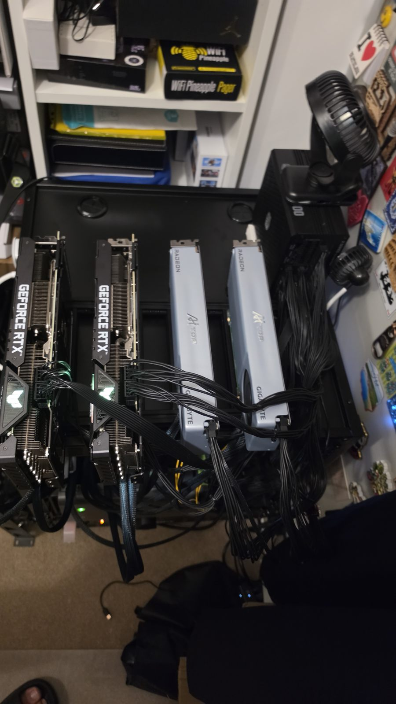

My GMKtec NEO-X1 Pro arrived as a compact gaming PC with one graphics card inside. It now drives five: two AMD Radeon AI PRO R9700s, two NVIDIA RTX 3090s and the RTX 5070 it shipped with. That is 124 GB of VRAM, and it runs a language model, a vision model, image generation and video generation at the same time, all of it at home.

This post is the overview: what the build is, what I like most about it, and which parts are worth copying even if you never go near five GPUs. Five follow-up posts will take it apart piece by piece.

If you have read my [old hacking lab build](/2020/08/29/hacking-server-lab.html), you will know where this is going. Give me a useful computer, some expansion hardware and a reason to experiment, and the desk tends to get a little more complicated.

*Disclosure: I bought the NEO-X1 Pro myself. This post is not sponsored by GMKtec, and the machine was not supplied or loaned for review.*

## The build in two tables

| Part | What I have |
|---|---|
| Host | GMKtec NEO-X1 Pro: Ryzen 9 9955HX3D (16 cores, 32 threads), 96 GB DDR5, 2 TB NVMe, in a 14.6-litre case |
| AMD cards | 2 × Gigabyte Radeon AI PRO R9700 AI TOP, 32 GB each |
| NVIDIA cards | 2 × ASUS TUF RTX 3090 OC, 24 GB each, and the ZOTAC RTX 5070 that came in the PC, 12 GB |
| Four of the cards | On a Broadcom PEX88096 PCIe switch card in the PC's single ×16 slot |
| The fifth card | On an AOOSTAR AG03 dock, over one OCuLink cable from an M.2 socket |
| Power | The PC's own 850 W supply, a Cooler Master X Mighty Platinum 2000 (2000 W) for the four cards, and the dock's built-in 800 W supply |
| Software | Windows 11 Pro, with Ubuntu under WSL2 for the main model |

**The NEO-X1 Pro is the centre of this build.** The extra GPUs, the switch, the cabling and the external power are my additions. They do not fit inside the GMKtec case, and this is my own tested configuration, not a five-GPU product you can buy.

This is what the cards do:

| Job | Model | Where it runs |
|---|---|---|
| Main language model | Qwen3.8-27B | One R9700 |
| Vision, for images and video | Qwen3.6-35B-A3B | The other R9700 |
| Image generation | Qwen-Image in ComfyUI | The RTX 5070 (the 3090s can do it too) |
| Video generation | MiniMax-H3 in ComfyUI | The two RTX 3090s |

The five cards do not add up to one 124 GB GPU. Each card owns its memory, and I give each job a card of its own.

## Pull the lab apart

  <iframe id="neox1-explorer" src="/neox1-lab/?embed=1" title="Interactive 3D exploded view of the NEO-X1 Pro AI lab" loading="lazy" style="display:block;width:100%;height:780px;border:1px solid #3c4933;border-radius:8px;" allow="fullscreen" allowfullscreen></iframe>

**[Explore the lab in a full window ↗](/neox1-lab/)**

Start with the GMKtec and open its chassis, or choose the R9700, RTX 3090, **PCIe switch** and **RTX 5070 + dock** close-ups. Drag to orbit and use the zoom buttons for detail. The **Complete rig** view shows the arrangement: the host on its side below with the switch card standing in its PCIe slot, four cards in their frame above with the power supply beside them, and the fifth on its dock alongside. Separate the assembly and turn on **PCIe links** to follow the shared connection and the separate route to the fifth GPU.

The models are reconstructed from the manufacturers' dimensions and my own photos, not from CAD, so hidden internals and exact cable routes are illustrative. The PCIe connections are the ones I measured.

## What I like most about it

**A gaming mini PC is doing a workstation's job.** GMKtec sells the NEO-X1 Pro as a compact gaming machine: a 14.6-litre case with carry handles, a liquid-cooled 16-core CPU and an RTX 5070. Inside there is one full-length PCIe slot and two M.2 sockets, and that turned out to be enough to hang five graphics cards off it. The PC still does everything else: CPU, memory, storage and the desktop.

**The processor is a laptop chip, and that suits this job.** The Ryzen 9 9955HX3D is what AMD calls the world's fastest mobile gaming processor: 16 Zen 5 cores, 32 threads, 3D V-Cache and a boost speed of up to 5.4 GHz. Because it was designed for laptops, AMD's default power rating for it is only 55 W. GMKtec puts it on a desktop board with liquid cooling and lets you choose how hard it runs: 54 W in silent mode, 85 W balanced, or 160 W for performance. That is a lot of processor for the power, and it comfortably covers what the CPU has to do here, which is run Windows, WSL and the services around the GPUs. I have not measured what the 3D V-Cache does for inference, so I am not crediting it for any of the speed figures below.

**One slot, four fast links.** The switch card takes the PC's single ×16 slot and gives each of four cards its own PCIe 4.0 ×16 connection. I measured 26 to 28 GB/s between the host and each card through it. For comparison, a card plugged straight into the slot measured 54 GB/s, and the PCIe 3.0 switch I tried first managed 3.5. The four cards do share one connection to the host, so when they all load models at once they split about 28 GB/s between them.

**One power supply feeds all four cards.** The cards on the switch run from a Cooler Master X Mighty Platinum 2000, a 2000 W unit that Cooler Master aims at servers and AI machines. Four cards need a surprising number of power leads. Each RTX 3090 takes two 8-pin plugs, each R9700 takes one 16-pin plug, and each of the four breakout boards has its own 6-pin socket to power the slot the card stands in. That is ten power connections for four cards, all from the one supply, and it is why the cabling looks the way it does in the photos. The supply is fully modular, so only the leads in use are attached. One thing to know if you copy this: its full 2000 W rating needs 200 to 240 V mains, and on 115 V Cooler Master rates it at 1600 W.

**The biggest speed-up cost nothing in hardware.** My main model used to be split across both R9700s. Moving it to a different inference stack, [mike2153's Qwen3.8 DFlash setup](https://github.com/mike2153/mbea-qwen38-dflash) on vLLM, made it faster on one card than it had been on two:

| | Two R9700s, llama.cpp | One R9700, vLLM with DFlash |
|---|---:|---:|
| Read a 115k-token prompt | 124 seconds | **51.6 seconds** |
| Generate after an 8k-token prompt | 62 tokens/s | **107 tokens/s** |
| Generate after a 115k-token prompt | 46 tokens/s | **74 tokens/s** |

These are medians of three runs from 10 October ([recorded values](/assets/neox1/inference-comparison.csv)). The change also freed a whole 32 GB card, which now runs the vision model.

**AMD and NVIDIA work in the same machine.** The 32 GB Radeons hold the language models, with room for very long conversations: the main model serves a context of about 214,000 tokens on a single card. The NVIDIA cards run the CUDA-based image and video tools. Neither vendor's cards are asked to do the other's job.

**It does several things at once.** A language model can plan a job, a vision model can check the result, and the image and video workers produce the assets, all at the same time on separate cards. I use it that way for an AI video pipeline. One experiment from that pipeline, [testing NVIDIA's Nemotron Bolt against my vision model](/2026/11/01/nemotron-bolt-vs-qwen36-vision-qa.html), already has its own post.

**Old cards are worth keeping.** I paid £511 for my first RTX 3090 in June 2024. In August 2026 I paid £1,000 for a second one, brand new, on eBay. A card that launched in 2020 nearly doubled in price in two years, and I put that down to demand for VRAM from people running AI models. Both cards are earning their keep here.

## How it got here

None of this started as a five-GPU plan. It started on an old MSI GS75 gaming laptop, which hosted my first setup of Hermes Agent, the AI agent I still run on top of these models, on its built-in mobile RTX 2080. When I wanted more VRAM, I plugged in my RTX 3090 through an original Razer Core X eGPU enclosure. That 3090 had already had a career: I used it for password cracking in my cyber security day job. Now it runs AI models.

I bought the first Radeon AI PRO R9700 in August. My thinking was that as better local models arrived, cards with a lot of VRAM would only get more expensive. So far that has held: the same card now costs £200 to £300 more than I paid. A second one followed quickly. The NEO-X1 Pro itself was good value on its launch deal.

From there, each step was a working machine before the next part arrived.

- **Late August:** the first R9700 runs in an eGPU dock on the laptop.
- **Early September:** the NEO-X1 Pro arrives. One card goes in its slot, then the OCuLink experiments begin.
- **Mid September:** two R9700s on a PCIe 3.0 switch, then the bigger PCIe 4.0 switch kit.
- **30 September:** four cards on the switch. On **4 October** the RTX 5070 joins on its dock, making five.
- **10 October:** the software change that moved the main model onto one card.
- **Start of November:** memory goes from 64 GB to 96 GB.



## The lab today

The GMKtec lies on its side on the lower level of a TecMojo 12U open rack, with its side panel off and the switch card plugged into the motherboard's PCIe slot. The shelf above carries the two RTX 3090s and the two Radeon AI PRO R9700s. The RTX 5070 sits beside the host on its dock, and the large external power supply is up beside the four-card shelf. A couple of small fans help move air around. This is very much a working homelab, cables and all.

<link rel="stylesheet" href="/assets/neox1/article.css">

  <figure>
    
    <figcaption><strong>01 / The whole build</strong>The NEO-X1 Pro anchors the lower level. The GPU expansion occupies the shelf above and the space beside it.</figcaption>
  </figure>
  <figure>
    
    <figcaption><strong>02 / Two GPU ecosystems</strong>Black RTX 3090s on the left, silver R9700s on the right, with external power and additional airflow.</figcaption>
  </figure>
  <figure>
    
    <figcaption><strong>03 / The expansion shelf</strong>The overhead view makes the four-card arrangement clear.</figcaption>
  </figure>

*Photos by me. Select a photo to open the full image.*

## You do not need all of it

The thing I would most like you to take from this build is that every stage of it was useful by itself. If I were starting again on a smaller budget, this is the order I would copy it in.

1. **Start with the software.** Before buying a second card, find out what the best inference stack for your first card can do. Mine read long prompts more than twice as fast and generated about 1.7 times as fast, on half the cards.
2. **Buy one card with plenty of VRAM.** A single 32 GB card runs my main model with a very long context. VRAM decides what you can load, and in my tests the software mattered more than a second card did.
3. **Add a second card with a dock.** An eGPU dock avoids rebuilding the PC. Mine, the [AOOSTAR AG03](https://aoostar.com/products/aoostar-ag03-egpu-dock), has a built-in 800 W power supply, an OCuLink port and two Thunderbolt 5 ports, and links at up to PCIe 4.0 ×4. I used it from a laptop over Thunderbolt before I owned the GMKtec, and I use it over OCuLink now. AOOSTAR publishes a short list of hardware it does not work with, so check that against your card first.
4. **Give each model its own card.** Two models on two cards have served me better than one model spread across two.
5. **Use a PCIe switch if you want three or four cards.** It turns one slot into several fast ones. It also needs a large external power supply, somewhere to stand the cards, and patience with cabling.
6. **Do not write off older cards.** A 2020 design with 24 GB is still doing useful work in this lab.

## What it costs

There are real trade-offs, and the follow-up posts will go into them.

- **Space.** Four cards stand in a frame on an open rack, and the fifth sits on a dock beside the PC.
- **Power.** The CPU is the small part of the bill. It is a laptop-class chip, and even GMKtec's fastest mode caps it at 160 W. The graphics cards are the large part: they run at their stock power limits, which for each RTX 3090 means up to 350 W. I could turn those limits down for better efficiency, and testing how much speed that costs is a future project. There are three power supplies in all, their ratings are not consumption figures, and I have not measured the lab at the wall yet.
- **A shared link.** The four cards on the switch share one connection to the host.
- **Memory.** Starting every service together on 64 GB left almost no free memory. The PC now has 96 GB, the most it supports.
- **Reliability.** It was unstable at first. The cause turned out to be an AMD driver problem: the driver moved an idle model out of the cards' memory, and the next request killed the card. A later driver release fixed that, and the lab has become steadily more reliable since. As I write this it has run for more than a week without a restart. It is still a homelab. I have had both RTX 3090s drop off the PCIe bus once, which took a reboot to clear, and my formal stress tests of the switch were only 15 minutes long.
- **Trusting what the system reports.** The link speed a card reports is not always the speed of the whole route back to the CPU. I measured transfers instead of trusting the report.

## What is coming

The rest of this series takes one piece at a time:

1. **The host.** What the NEO-X1 Pro gives you to work with, and what its PCIe slots can really do.
2. **The cards.** The R9700, the RTX 3090 and the RTX 5070: specifications, prices, and what each one is for.
3. **Getting GPUs outside the box.** Docks, OCuLink, two PCIe switches, external power and a frame to hold it all.
4. **Making the models fast.** Inference engines, how I tune and test, and the benchmarks.
5. **Running it every day.** Starting five services in order, monitoring them, what has broken, and which configuration I would build again.

For GMKtec, I think there is a good enthusiast story here: a compact machine becoming the foundation of a much more ambitious project. I would love to collaborate on a follow-up covering repeatable builds, measured power and noise, and longer inference runs.

For now, I have a GMKtec at the centre of five GPUs, AMD and NVIDIA doing useful work in the same system, and a local language model that got substantially quicker through a change of software. That is a pretty good excuse for the state of my desk.

---

*Build and measurements recorded August to November 2026. The 3D illustration is schematic. Product specifications: [GMKtec NEO-X1 Pro](https://www.gmktec.com/products/gmktec-neo-x1-pro-modt-gaming-pc-amd-ryzen-9-9955hx3d-nvidia-geforce-rtx-5070), [AMD Ryzen 9 9955HX3D](https://www.amd.com/en/products/processors/laptop/ryzen/9000-series/amd-ryzen-9-9955hx3d.html), [AOOSTAR AG03](https://aoostar.com/products/aoostar-ag03-egpu-dock) and [Cooler Master X Mighty Platinum 2000](https://www.coolermaster.com/en-global/products/x-mighty-2000.html). Inference software credit: [mbea-qwen38-dflash](https://github.com/mike2153/mbea-qwen38-dflash), its linked radiance/libr4d projects, [vLLM](https://github.com/vllm-project/vllm), [llama.cpp](https://github.com/ggml-org/llama.cpp) and [ComfyUI](https://github.com/Comfy-Org/ComfyUI). Interactive rendering uses [Three.js](https://threejs.org/).*
