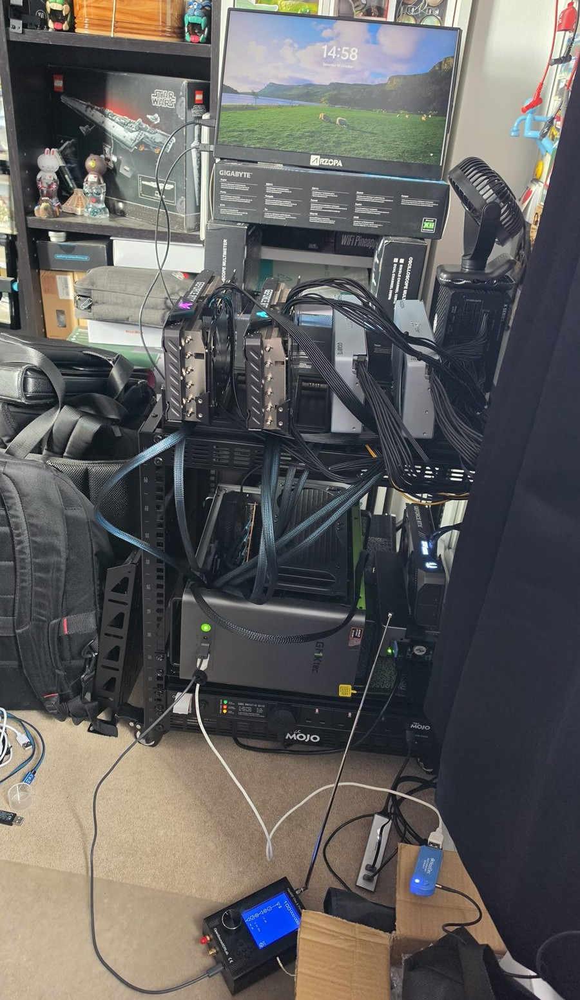
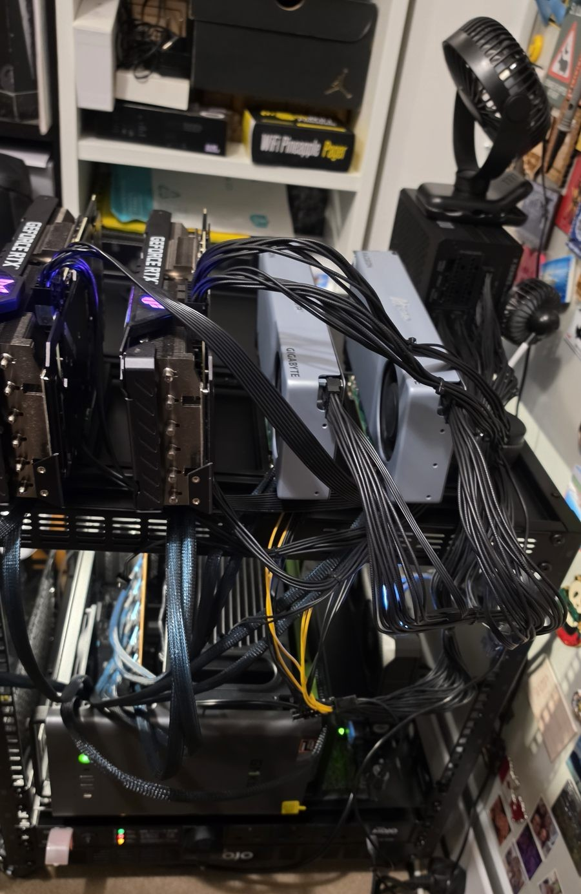
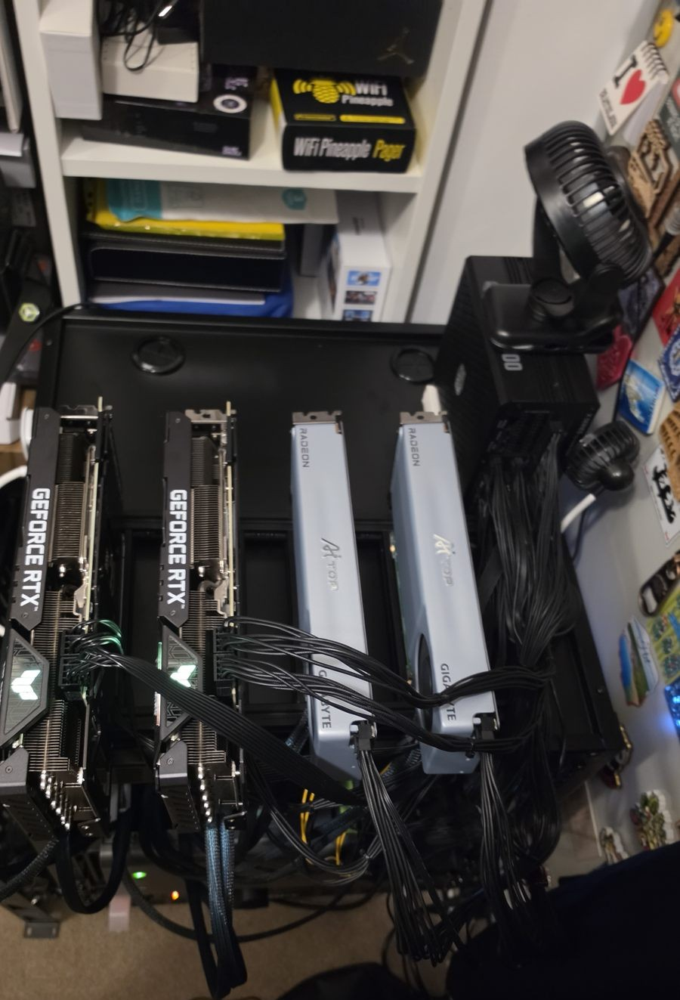
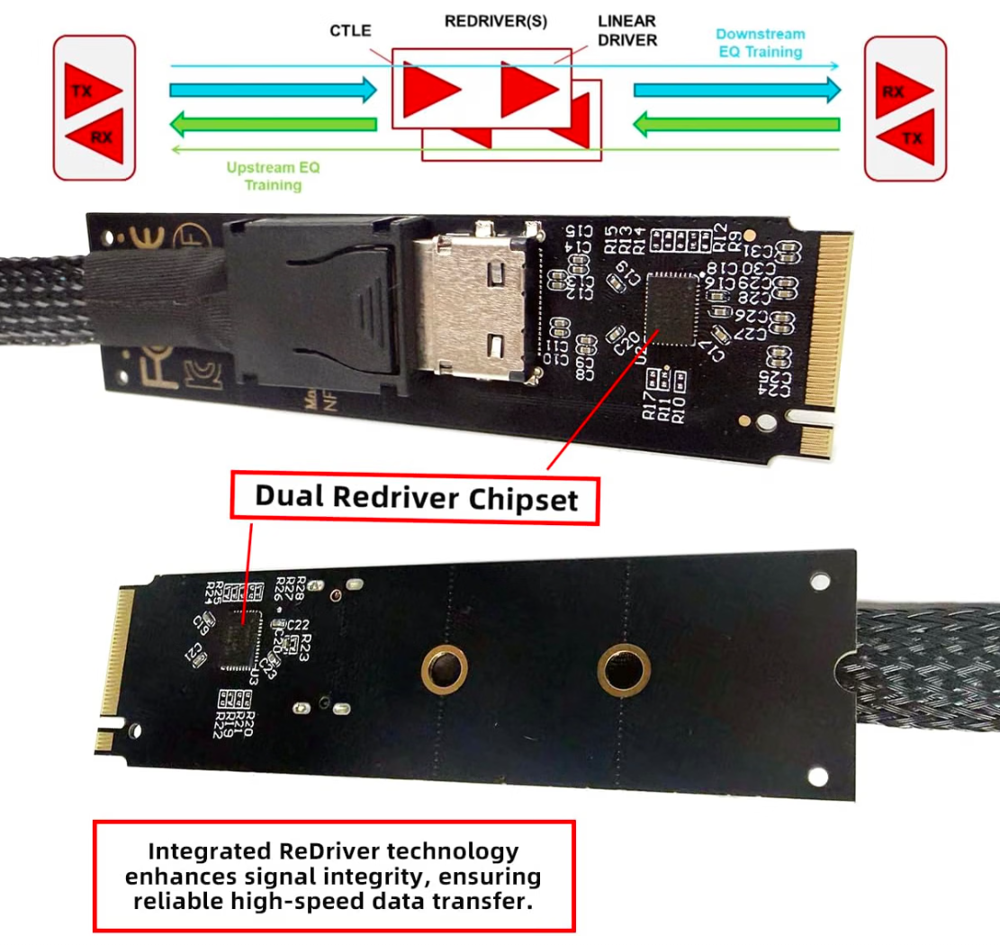

How far can one PCIe slot take local AI? On a compact gaming PC with one full-length slot, I now run five GPUs and 124 GB of VRAM: a language model, a vision model, image generation and video generation, all at the same time, all at home, with no cloud and no API bill. The surprise was where the biggest speed-up came from. It was software, not hardware: one change made my main model more than twice as fast at reading long prompts, on half the cards.

<link rel="stylesheet" href="/assets/neox1/article.css">
<nav class="post-toc" aria-label="Contents" markdown="1">

Contents

* TOC
{:toc}

</nav>

This post covers what the build is, what I like most about it, and which parts are worth copying even if you never go near five GPUs.

If you have read my [old hacking lab build](/2020/08/29/hacking-server-lab.html), you will know where this is going. Give me a useful computer, some expansion hardware and a reason to experiment, and the desk tends to get a little more complicated.

*Disclosure: I bought all of the hardware in this build myself: the NEO-X1 Pro, every graphics card, the PCIe switch kit, the dock and the power supply. None of it is sponsored by any of the component manufacturers, so far, and nothing was supplied or loaned for review.*

## The build in two tables

| Part | What I have |
|---|---|
| Host | GMKtec NEO-X1 Pro: Ryzen 9 9955HX3D (16 cores, 32 threads), 96 GB DDR5, 2 TB NVMe, in a 14.6-litre case |
| AMD cards | 2 × Gigabyte Radeon AI PRO R9700 AI TOP, 32 GB each |
| NVIDIA cards | 2 × ASUS TUF RTX 3090 OC, 24 GB each, and the ZOTAC RTX 5070 that came in the PC, 12 GB |
| Four of the cards | On a Broadcom PEX88096 PCIe switch card in the PC's single ×16 slot |
| The fifth card | On an AOOSTAR AG03 dock, over one OCuLink cable from an M.2 socket |
| Power | The PC's own 850 W supply, a Cooler Master X Mighty Platinum 2000 (2000 W) for the four cards, and the dock's built-in 800 W supply |
| Software | Windows 11 Pro, with Ubuntu under WSL2 for the main model |

**The NEO-X1 Pro is the centre of this build.** The extra GPUs, the switch, the cabling and the external power are my additions. They do not fit inside the GMKtec case, and this is my own tested configuration, not a five-GPU product you can buy.

This is what the cards do:

| Job | Model | Where it runs |
|---|---|---|
| Main language model | Qwen3.8-27B | One R9700 |
| Vision, for images and video | Qwen3.6-35B-A3B | The other R9700 |
| Image generation | Qwen-Image in ComfyUI | The RTX 5070 (the 3090s can do it too) |
| Video generation | MiniMax-H3 in ComfyUI | The two RTX 3090s |

The five cards do not add up to one 124 GB GPU. Each card owns its memory, and I give each job a card of its own.

## Pull the lab apart

  <iframe id="neox1-explorer" src="/neox1-lab/?embed=1" title="Interactive 3D exploded view of the NEO-X1 Pro AI lab" loading="lazy" style="display:block;width:100%;height:780px;border:1px solid #3c4933;border-radius:8px;" allow="fullscreen" allowfullscreen></iframe>

**[Explore the lab in a full window ↗](/neox1-lab/)**

Pick a part for a close-up, or open the **Complete rig** view, separate the assembly and turn on **PCIe links** to follow how each card connects. The models are reconstructed from manufacturers' dimensions and my own photos, not CAD, so hidden internals and cable routes are illustrative. The PCIe connections are the ones I measured.

## What I like most about it

**A gaming mini PC is doing a workstation's job.** The NEO-X1 Pro is sold as a compact gaming machine with one full-length PCIe slot and two M.2 sockets. That turned out to be enough to hang five graphics cards off it, with the [PCIe switch](#the-pcie-switch-one-slot-many-gpus) doing the heavy lifting. Its Ryzen 9 9955HX3D is a 16-core laptop chip that GMKtec runs at 54, 85 or 160 W, which is plenty for Windows, WSL and the services around the GPUs.

**One power supply feeds the four switch cards.** A Cooler Master X Mighty Platinum 2000 drives ten power connections: two 8-pin plugs per RTX 3090, one 16-pin per R9700 and a 6-pin for each breakout board. If you copy this, its full 2000 W rating needs 200 to 240 V mains. On 115 V it is rated at 1600 W.

**The biggest speed-up cost nothing in hardware.** Moving my main model from llama.cpp across both R9700s to [mike2153's Qwen3.8 DFlash setup](https://github.com/mike2153/mbea-qwen38-dflash) on vLLM made it faster on one card than it had been on two:

| | Two R9700s, llama.cpp | One R9700, vLLM with DFlash |
|---|---:|---:|
| Read a 115k-token prompt | 124 seconds | **51.6 seconds** |
| Generate after an 8k-token prompt | 62 tokens/s | **107 tokens/s** |
| Generate after a 115k-token prompt | 46 tokens/s | **74 tokens/s** |

These are medians of three runs from 10 October ([recorded values](/assets/neox1/inference-comparison.csv)). The change also freed a 32 GB card for the vision model.

**AMD and NVIDIA share the work.** The 32 GB Radeons hold the language models, and the main one serves a context of about 214,000 tokens on a single card. The NVIDIA cards run the CUDA-based image and video tools. Because every job has its own card, they all run at once, which I use for an AI video pipeline. One experiment from it, [testing NVIDIA's Nemotron Bolt against my vision model](/2026/11/01/nemotron-bolt-vs-qwen36-vision-qa.html), has its own post.

**Old cards are worth keeping.** My first RTX 3090 cost £511 in June 2024. A brand-new second one cost £1,000 in August 2026. A 2020 card nearly doubled in price, which I put down to demand for VRAM, and both are earning their keep here.

## How it got here

None of this started as a five-GPU plan. It started on an old MSI GS75 gaming laptop, which hosted my first setup of Hermes Agent, the AI agent I still run on top of these models, on its built-in mobile RTX 2080. When I wanted more VRAM, I plugged in my RTX 3090 through an original Razer Core X eGPU enclosure. That 3090 had already had a career: I used it for password cracking in my cyber security day job. Now it runs AI models.

I bought the first Radeon AI PRO R9700 in August. My thinking was that as better local models arrived, cards with a lot of VRAM would only get more expensive. So far that has held: the same card now costs £200 to £300 more than I paid. A second one followed quickly. The NEO-X1 Pro itself was good value on its launch deal.

From there, each step was a working machine before the next part arrived.

- **Late August:** the first R9700 runs in an eGPU dock on the laptop.
- **Early September:** the NEO-X1 Pro arrives. One card goes in its slot, then the OCuLink experiments begin.
- **Mid September:** two R9700s on a PCIe 3.0 switch, then the bigger PCIe 4.0 switch kit.
- **30 September:** four cards on the switch. On **4 October** the RTX 5070 joins on its dock, making five.
- **10 October:** the software change that moved the main model onto one card.
- **Start of November:** memory goes from 64 GB to 96 GB.



## The PCIe switch: one slot, many GPUs

Most consumer PCs, and nearly every mini PC, have one full-length PCIe slot. That is the wall most people hit when they want a second or third graphics card. A Thunderbolt dock or an M.2-to-OCuLink adapter can add a card, but at ×4 at best, and the OCuLink route uses up an M.2 socket. Splitting the slot itself, which is called bifurcation, needs support in the BIOS and divides the slot's sixteen lanes between the cards.

A PCIe switch works differently. It behaves like a network switch for PCIe: one link goes up to the computer, and several full-width links come down to the devices. The chip on my card is a Broadcom **PEX88096**, which has 96 PCIe 4.0 lanes. Sixteen of them form the ×16 link to the PC. The other 80 come out as ten SFF-8654 (SlimSAS) ports, each eight lanes wide. A graphics card takes two ports, so the card can run up to five GPUs at full ×16, ten devices at ×8, or as many as twenty NVMe drives at ×4. The computer sees ordinary PCIe devices, so there are no special drivers.

| Specification | Supplier's figure |
|---|---|
| Product | PEX88096 PCIe 4.0 ×16 expansion card, model RTE88096-A54 |
| Host link | PCIe 4.0 ×16 (16 GT/s per lane) |
| Downstream ports | 10 × SFF-8654-8i, each PCIe ×8 |
| Devices | Up to 20 (5 at ×16, 10 at ×8, 20 at ×4) |
| Port modes | ×16, ×8×8 or ×4×4×4×4, set by a DIP switch |
| Size | 247 × 111.2 mm, full length |
| Power | From the PCIe slot (12 V and 3.3 V) |

I bought it as a kit [from this supplier on Alibaba](https://www.alibaba.com/product-detail/PEX88096-PCIe-4-0-X16-Expansion_1601814406633.html), and they were very responsive when I had questions. The kit comes with the switch card, ten SFF-8654 cables, and interface boards that each give a graphics card a normal ×16 slot fed by two cables. Each interface board also needs its own 6-pin power lead for the slot.



*Product photos from the supplier's listing.*

### What I measured

Each card behind the switch trained at PCIe 4.0 ×16. On 30 September a single R9700 moved 28.3 GB/s from the host and a single RTX 3090 moved 26.1 GB/s. A 15-minute soak moved 32.2 TB with no PCIe errors. For comparison, a card plugged straight into the slot measured 54 GB/s, because the slot itself is PCIe 5.0. The cheaper PCIe 3.0 card I tried first, described next, managed 3.5 GB/s per card.

### The cheaper option I tried first

Before the PEX88096, I ran two R9700s from a much smaller switch card: the CEACENT CNOL4PE08, [from another Alibaba supplier](https://www.alibaba.com/product-detail/CEACENT-CNOL4PE08-Server-PCI-Express-3_1601511777867.html). It uses Broadcom's older PEX8724, a 24-lane PCIe 3.0 switch, on a short ×8 card with four OCuLink ports. It is sold for NVMe drives, but each port carries four PCIe lanes, which is exactly what an OCuLink eGPU enclosure expects. Because the card has its own switch chip, it does the splitting itself.

| Specification | Supplier's figure |
|---|---|
| Product | CEACENT CNOL4PE08 |
| Switch chip | Broadcom PEX8724 |
| Host link | PCIe 3.0 ×8 |
| Downstream ports | 4 × SFF-8611 (OCuLink), PCIe 3.0 ×4 each |
| Speed | About 4 GB/s per port ("single disk 4GB/s") |
| Size | 172 × 69 mm, with half- and full-height brackets |
| Operating temperature | 0 to 55 °C |



*Product photos from the supplier's listing.*

From 11 to 16 September it ran two R9700s, each in its own OCuLink eGPU enclosure, and it did its job:

- Each card moved 3.5 GB/s, about 89% of what a PCIe 3.0 ×4 link can carry.
- With both cards flat out at once they moved 7 GB/s between them, so the ×8 link to the PC was not the bottleneck at two cards. A six-minute run moved 2.5 TB with no PCIe errors.
- A language model split across the two cards generated a steady 30 tokens/s.

The PC crashed repeatedly that week, and at first I blamed the cheap card and one of the enclosures. It was neither. The same crash happened with a card plugged straight into the PC's slot, and the cause was the AMD driver bug I describe under [What it costs](#what-it-costs). If something goes wrong, reproduce it without the cheap part before you blame the cheap part.

I moved on for room to grow, not because the card failed. Four ports cap it at four cards, each at PCIe 3.0 ×4, and all four would share the ×8 link to the PC. The PEX88096 gives each card eight times the measured bandwidth and has ports to spare. If you only want two cards and keep each model on its own card, the cheaper card is a sensible place to start.

### What a switch does not do

- **It does not add bandwidth to the PC.** The four cards share the one ×16 link, so when all four load models at once they split about 28 GB/s between them. Once a model sits entirely on one card, it barely uses the link, which is why this works so well for one model per card.
- **It does not merge the cards' memory.** Five cards are still five separate pools of VRAM.
- **It does not give you GPU-to-GPU transfers on Windows.** The switch could route traffic straight between two cards, but the drivers do not allow it. NVIDIA blocks peer-to-peer on GeForce cards, and the R9700s report no peers. Copies between cards go through system RAM, which is one more reason to give each model its own card.
- **It does not power or hold the cards.** The cards need an external power supply, the interface boards need their own leads, and you need a frame to stand everything in.

## The lab today

The GMKtec lies on its side on the lower level of a TecMojo 12U open rack, with its side panel off and the switch card plugged into the motherboard's PCIe slot. The shelf above carries the two RTX 3090s and the two Radeon AI PRO R9700s. The RTX 5070 sits beside the host on its dock, and the large external power supply is up beside the four-card shelf. A couple of small fans help move air around. This is very much a working homelab, cables and all.

  <figure>
    
    <figcaption><strong>01 / The whole build</strong> The NEO-X1 Pro anchors the lower level. The GPU expansion occupies the shelf above and the space beside it.</figcaption>
  </figure>
  <figure>
    
    <figcaption><strong>02 / Two GPU ecosystems</strong> Black RTX 3090s on the left, silver R9700s on the right, with external power and additional airflow.</figcaption>
  </figure>
  <figure>
    
    <figcaption><strong>03 / The expansion shelf</strong> The overhead view makes the four-card arrangement clear.</figcaption>
  </figure>

*Photos by me. Select a photo to open the full image.*

## You do not need all of it

The thing I would most like you to take from this build is that every stage of it was useful by itself. If I were starting again on a smaller budget, this is the order I would copy it in.

1. **Start with the software.** Before buying a second card, find out what the best inference stack for your first card can do. Mine read long prompts more than twice as fast and generated about 1.7 times as fast, on half the cards.
2. **Buy one card with plenty of VRAM.** A single 32 GB card runs my main model with a very long context. VRAM decides what you can load, and in my tests the software mattered more than a second card did.
3. **Add a second card with a dock.** An eGPU dock avoids rebuilding the PC. Mine, the [AOOSTAR AG03](https://aoostar.com/products/aoostar-ag03-egpu-dock), has a built-in 800 W power supply, an OCuLink port and two Thunderbolt 5 ports, and links at up to PCIe 4.0 ×4. I used it from a laptop over Thunderbolt before I owned the GMKtec, and I use it over OCuLink now. AOOSTAR publishes a short list of hardware it does not work with, so check that against your card first.
4. **Give each model its own card.** Two models on two cards have served me better than one model spread across two.
5. **Use a PCIe switch if you want three or four cards.** It turns one slot into several fast ones. It also needs a large external power supply, somewhere to stand the cards, and patience with cabling.
6. **Do not write off older cards.** A 2020 design with 24 GB is still doing useful work in this lab.

## Tips for getting more out of local AI

Most of the speed in this lab came from software and settings, not from extra hardware. These tips come from my own benchmark notes from August to October. Your numbers will differ, which is why the first two are about measuring.

### Measure before you change anything

- **Benchmark with real prompts, and repeat each run.** Use fixed prompts from your actual work, run each one at least three times, take the median and drop the first warm-up run. Synthetic text misleads. With speculative decoding, how often the draft's guesses were accepted depended on the prompt: 0.54 on synthetic repeated text, 0.48 on a real document with no instruction, and 0.66 on the same document with an instruction at the end. Twelve identical runs on an RTX 3090 ranged from 53 to 61 tokens/s, so I ignore differences smaller than about 3 tokens/s.
- **Check the card is empty, and trust the operating system for free memory.** I threw away one run because another model was already on the card. 21 GB spilled into shared system memory, and reading the prompt took three times as long. One runtime reported both R9700s as about 32 GB free while another server held 30 GB of one of them. Windows' own GPU memory counters were right.

### Choosing hardware

- **Memory bandwidth sets the speed limit.** To generate each token, the card reads the whole model (for a mixture-of-experts model, the active part) from its memory. So tokens per second is roughly memory bandwidth divided by model size. The RTX 5070 has 672 GB/s, and a 6.74 GB model on it measured 89 tokens/s against a ceiling of about 100. Do this sum before you buy a card.
- **Buy an M.2-to-OCuLink adapter with a redriver.** An M.2 socket is the easiest way to get another card out of a small PC. But a PCIe 4.0 signal loses quality through the adapter board, the connector and the cable. A redriver is a small chip on the adapter that boosts and cleans up the signal before it goes down the cable. My first adapter had no redriver, and the card on the other end never appeared in Windows. [This one](https://www.amazon.co.uk/dp/B0G2GBYQS5), with PX410 redriver chips (pictured below), worked, and it has carried the RTX 5070 at PCIe 4.0 ×4 since October. Look for "redriver" (or "retimer", a stronger kind of signal repeater) in the listing, and buy the OCuLink cable separately.

<figure class="neox1-figure">
  
  <figcaption><strong>The adapter that worked</strong> It has two redriver chips, one on each side of the board, that boost and equalise the PCIe signal on its way through the adapter and the cable. The diagram shows where they sit in the link. Product image from the seller's listing.</figcaption>
</figure>

### Engines and settings

- **Try more than one engine and backend.** Switching to vLLM with DFlash was my biggest win (see the table above). On AMD cards, llama.cpp has two GPU backends, ROCm and Vulkan, and neither won everything. With Qwen3.8-27B on one R9700, ROCm read prompts 25 to 30% faster and Vulkan generated about 10% faster. For my vision model's short-prompt workload, Vulkan finished the whole job 16% sooner. Long documents favour fast prompt reading, and chat and short agent calls favour fast generation.
- **If a model spans two cards, test the split modes.** Layer split is the default. Row split no longer works on llama.cpp's Vulkan backend, and tensor split on Vulkan was 39% slower for me. ROCm with tensor split beat Vulkan with layer split: 65 against 52 tokens/s generating, and 1.65 to 1.9 times as fast reading prompts.
- **Keep speculative drafts short.** Speculative decoding lets a small draft model guess a few tokens ahead for the big model to check. Drafting three or four tokens with Nemotron Bolt's drafter was 10 to 40% faster than no drafter. NVIDIA's default of seven was slower than no drafter, except on code. With llama.cpp's built-in draft head, drafting two tokens and three tokens came out within 1% of each other.
- **Forum defaults are not universal.** A bigger micro-batch (`-ub 2048`) is often recommended, but on my R9700s it was 5 to 7% slower than 1024. Quantising the KV cache to `q8_0` saves memory, but in one setup it lowered draft acceptance and cut generation from 56 to 45 tokens/s. Change one setting at a time and measure each.
- **On Windows, turn off memory-mapped loading.** In llama.cpp that is `--load-mode none` (`--no-mmap` on older builds). It saved about 12.3 GB of system RAM per RTX 3090 server, at the same speed. Windows still reserves memory for each server, so give it a large page file. Peak committed memory here reached 140 GB, which is part of why I went to 96 GB of RAM.
- **Give the server a second slot if an agent uses it.** With one slot in llama.cpp, a small extra request pushed a 115,000-token conversation out of the cache, and the next turn re-read the whole prompt: 120 seconds. With two slots (`-np 2 -kvu`), the conversation stayed in the cache, and the next turn took 1.6 seconds.

### Vision and image models

- **Shrink inputs before you send them.** A 10-second video scaled down to 640 pixels before sending went from 5,519 tokens to 2,519, and from 3.5 seconds to 1.5, with the same answer. For reading exact text or tables, use a low temperature, around 0.1. My table-reading errors at 0.7 turned out to be sampling noise.
- **In ComfyUI, check the real output size before blaming VRAM.** A Qwen-Image text-encoder node left at resolution 0 sized every image from a 2688 × 1536 reference picture. The jobs were 4.1 megapixels and took 58 seconds instead of 8.

## What it costs

There are real trade-offs.

- **Space.** Four cards stand in a frame on an open rack, and the fifth sits on a dock beside the PC.
- **Power.** The CPU is the small part of the bill. It is a laptop-class chip, and even GMKtec's fastest mode caps it at 160 W. The graphics cards are the large part: they run at their stock power limits, which for each RTX 3090 means up to 350 W. Lowering them would save power at some cost in speed. There are three power supplies, their ratings are not consumption figures, and I have not measured the lab at the wall.
- **Memory.** Starting every service together on 64 GB left almost no free memory. The PC now has 96 GB, the most it supports.
- **Reliability.** It was unstable at first. The cause turned out to be an AMD driver problem: the driver moved an idle model out of the cards' memory, and the next request killed the card. A later driver release fixed that, and the lab has become steadily more reliable since. As I write this it has run for more than a week without a restart. It is still a homelab. I have had both RTX 3090s drop off the PCIe bus once, which took a reboot to clear, and my formal stress tests of the switch were only 15 minutes long.
- **Trusting what the system reports.** The link speed a card reports is not always the speed of the whole route back to the CPU. I measured transfers instead of trusting the report.

## Final thoughts

There is a lot more to say about each part of this build, so I may come back to some of it in later posts. I also think there is a good enthusiast story here for GMKtec and the other makers involved: a compact gaming PC becoming the foundation of a much more ambitious project.

For now, I have a GMKtec at the centre of five GPUs, AMD and NVIDIA doing useful work in the same system, and a local language model that got substantially quicker through a change of software. That is a pretty good excuse for the state of my desk.

---

*Build and measurements recorded August to November 2026. The 3D illustration is schematic. Product specifications: [GMKtec NEO-X1 Pro](https://www.gmktec.com/products/gmktec-neo-x1-pro-modt-gaming-pc-amd-ryzen-9-9955hx3d-nvidia-geforce-rtx-5070), [AMD Ryzen 9 9955HX3D](https://www.amd.com/en/products/processors/laptop/ryzen/9000-series/amd-ryzen-9-9955hx3d.html), [AOOSTAR AG03](https://aoostar.com/products/aoostar-ag03-egpu-dock) and [Cooler Master X Mighty Platinum 2000](https://www.coolermaster.com/en-global/products/x-mighty-2000.html). Inference software credit: [mbea-qwen38-dflash](https://github.com/mike2153/mbea-qwen38-dflash), its linked radiance/libr4d projects, [vLLM](https://github.com/vllm-project/vllm), [llama.cpp](https://github.com/ggml-org/llama.cpp) and [ComfyUI](https://github.com/Comfy-Org/ComfyUI). Interactive rendering uses [Three.js](https://threejs.org/).*
