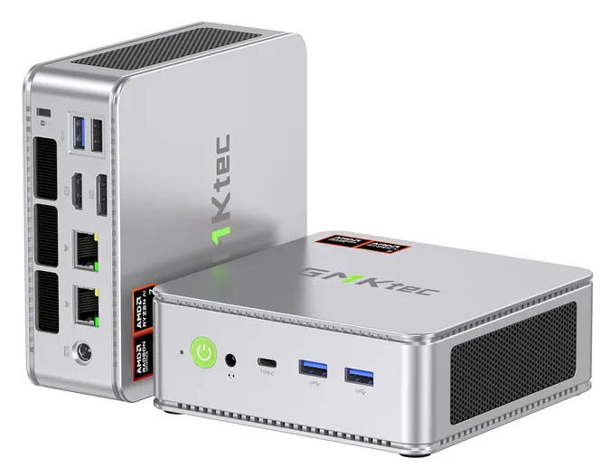
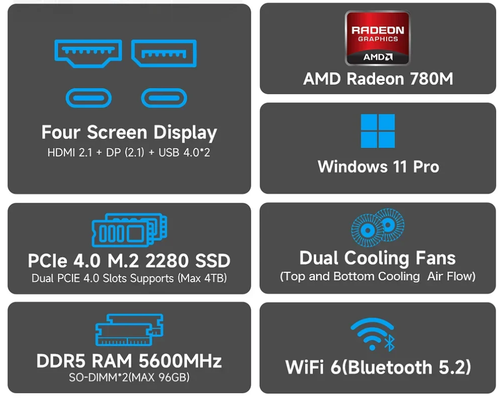
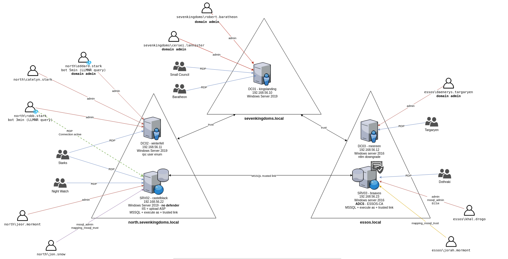
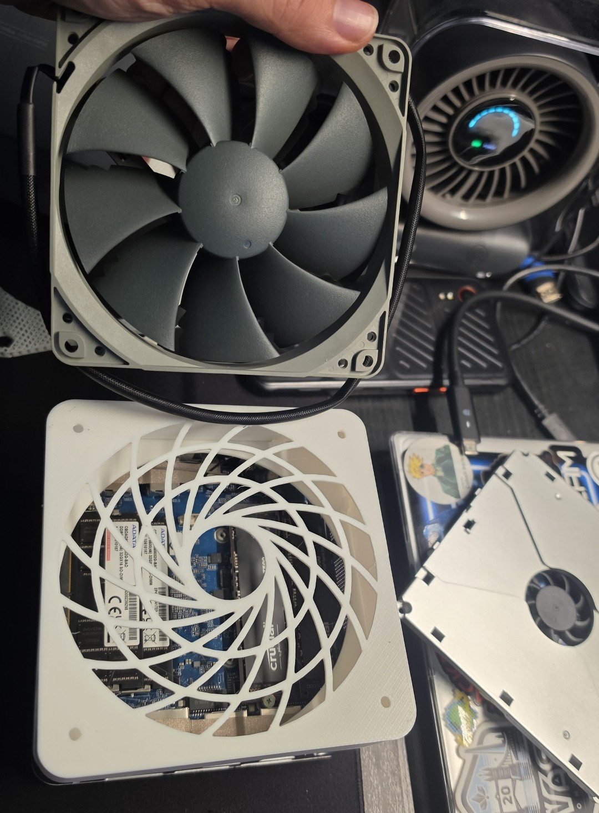
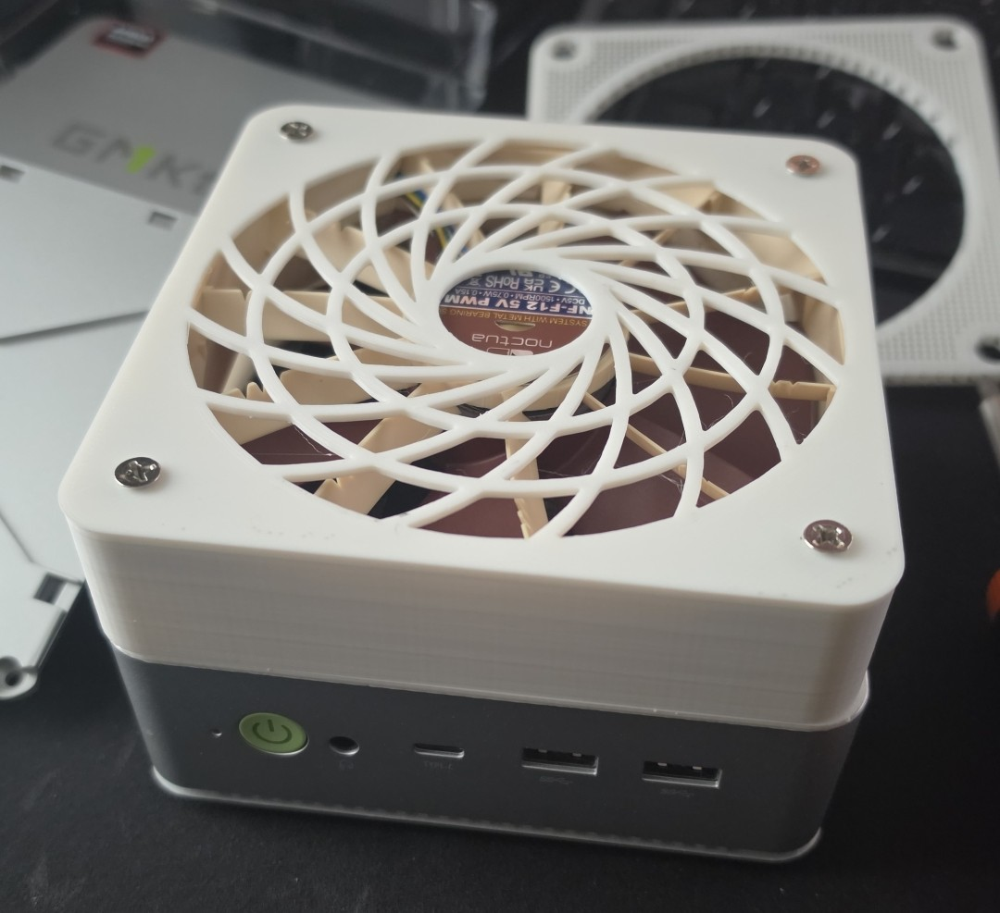

Every red teamer, detection engineer and malware analyst eventually hits the same wall: you need somewhere *safe and realistic* to practise. Somewhere you can build a full Active Directory estate, detonate tooling, break things, and roll it all back without touching a client, a corporate network, or your own machine. The usual answer is "spin it up in the cloud", but that bill adds up fast, and cyber ranges have an awkward requirement (hardware virtualisation) that makes cloud hosting either expensive or fiddly. A good answer is just to run it at home, on a mini PC the size of a decently stacked sandwich, with [Ludus](https://docs.ludus.cloud/) doing most of the heavy architectural systems lifting.

# What Is Ludus?

Ludus is an open-source project from [Bad Sector Labs](https://gitlab.com/badsectorlabs/ludus) that bills itself as **"Cyber Ranges for Everyone."** Under the hood it stitches together **Proxmox** (the hypervisor), **Packer** (for building VM templates) and **Ansible** (for configuring everything), and wraps the lot in a simple CLI and API.

The model is beautifully simple:

- **Templates** are golden images (Windows Server, Windows 11, Debian, Kali and more) built once from ISO with Packer, with no customisation baked in.
- **Ranges** are whole networks defined in a single YAML file: which VMs, which template, how much RAM, which VLAN, which roles.
- **Roles** are Ansible roles that turn a blank VM into something useful: a domain controller, a domain-joined workstation, an Elastic server, a vulnerable web app, whatever you like.

Define your range in config, run one command, and Ludus builds the VMs, networks them, joins them to a domain, and applies your roles. Snapshot it, trash it, redeploy it. It is infrastructure-as-code for an entire adversary playground.

Ludus 2 added two things worth knowing about. [**Blueprints**](https://docs.ludus.cloud/docs/using-ludus/blueprints) let you save a deployed range as a reusable, shareable package, and [**sources**](https://docs.ludus.cloud/docs/category/using-ludus) are catalogues of templates, roles and blueprints you can install from a git repo. Bad Sector Labs publish one that ships ready-made **GOAD** and **AD + Elastic** labs, so "build me a vulnerable multi-domain forest" is now literally one command. There is also a web UI, but that is a Pro/Enterprise feature; the CLI and API are free and they are all you need at home.

# Why It's So Useful

- **Active Directory playgrounds on demand.** A realistic domain (DC, workstations, users, misconfigurations) is the single best thing to practise red teaming against. Ludus stands one up in minutes, and because it's all config you can version it, share it, and rebuild it identically every time.
- **A proper lab for malware development and detection.** Spin up an *isolated*, snapshot-backed Windows VM, build and detonate your tooling inside it, and watch what your EDR and logging actually catch. This is where offence and defence meet: the point isn't just to build something that works, it's to see what it looks like from the blue side and tune detections accordingly. Keep these VMs off any real network. That is the whole idea.
- **Reproducibility.** Broke the lab? Destroy the range and redeploy. No more "I'll never get this environment back" anxiety.
- **Testing mode.** One command snapshots every VM and cuts their internet access; another reverts them. Deploy clean, snapshot, attack, revert. Perfect for building repeatable detection test cases.

# Another GMKtec Computer with a Very Different Job

If you read my two posts on hardware implants, you already know I have a soft spot for GMKtec's little boxes. In [Part 1](/2026/10/12/physical-network-implants.html) the **NucBox G5** was the attacker's box: a palm-sized Kali machine we drop behind a desk on a physical engagement, with a cellular uplink so its traffic never touches the client's network. [Part 2](/2026/10/13/hardware-implants-part-2.html) went smaller still, down to cables and keyboards.

This post flips it round. The **NucBox K8** is the box that stays at home and gets *attacked*. It hosts the fake victims network domain, the workstations, the SIEM, and the Kali box that goes after them. Same vendor family, opposite side of the engagement. (And yes, there is a third one: my **NEO-X1 Pro** has grown to five GPUs and become a local AI lab. That is the next post.)

# The Hardware: Why a Mini PC Makes Sense

Ludus's requirements are refreshingly modest. Per the [install docs](https://docs.ludus.cloud/docs/quick-start/install-ludus), you need:

- An x86_64 CPU with a [Passmark](https://www.cpubenchmark.net/cpu_list.php) score above 6,000
- Hardware virtualisation (`vmx`/`svm` in `/proc/cpuinfo`; nested virtualisation works with a performance hit)
- Debian 12/13 (or Proxmox 8/9)
- **At least 32 GB of RAM** (ideally 64GB as it allows you to run more VMs at once) and **250+ GB of disk**, fast NVMe recommended
- A **wired** connection. Wi-Fi is explicitly not supported for the host (it's too flaky and the install fails), and Docker must not be installed on it either.

That's a spec a modern mini PC laughs at. I run mine on a **GMKtec NucBox K8**, the original silver model, which is the exact box the Ludus authors use themselves and recommend in their [bare-metal guide](https://docs.ludus.cloud/docs/deployment-options/bare-metal). It's an **AMD Ryzen 7 8845HS** (8 cores / 16 threads) that scores about **29,000** on Passmark, nearly five times the Ludus floor, so the CPU is never the bottleneck, and Proxmox does a good job of sharing it out between the VMs.



Here is what's inside it. Pull it apart, click the callouts, and flick on "Ludus essentials" to see the three things that actually matter for a range host.

<div class="k8-embed" style="margin:1.5rem 0;">
  <iframe id="k8-explorer" src="/k8-range/?embed=1" title="Interactive exploded isometric view of the GMKtec NucBox K8" loading="lazy" style="display:block;width:100%;height:820px;border:1px solid #3c4933;border-radius:8px;" allow="fullscreen" allowfullscreen></iframe>
</div>
<script src="/assets/k8/embed.js" defer></script>

**[Open the exploded view full screen ↗](/k8-range/)**

The case dimensions are the manufacturer's; the internal layout follows the published teardowns (lid off, four screws, fan tray out, and you're at the memory and storage). It's a reconstruction, not CAD.

The two things that matter for a range host are **RAM and storage**, and this is where the mini PC route shines:

- **RAM:** GMKtec's spec sheet quoted a conservative 64 GB ceiling, but the 8845HS and its two DDR5 SO-DIMM slots happily take a 2 × 48 GB kit. I bought **96 GB** when DDR5 was cheap, and Ludus's own K8 runs the same. That headroom is the difference between running two VMs and running a whole domain plus a SIEM at once. That said, once I'd tuned the VMs' memory allocations the range didn't need it all, so the 96 GB kit has since moved to my NEO-X1 Pro and the K8 now runs happily on 64 GB of ADATA.
- **Storage:** two M.2 2280 PCIe 4.0 slots. Every Windows template provisions a big virtual disk, and VM disk I/O is what makes a range feel snappy, so a large Gen4 NVMe (or two) is non-negotiable. The Ludus team run 2 × 2 TB in RAID 0; they admit that's overkill and suggest 2 × 1 TB. I went overkill too, and after a year or so I've realised 2 × 2 TB in RAID 0 isn't really needed.
- **Network:** two 2.5 GbE ports. Ludus assumes a single, plain wired interface and builds all of its range networks virtually behind it, so one patch lead is all you need. The second port is spare.

Here's mine going together back in July 2024, where it lives now, and what two years of running 24/7 did to its fan (more on that at the end). Use the buttons, or your arrow keys once you've clicked into the gallery, to step through.



GMKtec no longer sells the original K8. The current version is the [**NucBox K8 Plus**](https://www.gmktec.uk/products/gmktec-nucbox-k8-plus-amd-ryzen%E2%84%A2-7-8845hs-mini-pc) (about £410 with 32 GB and 1 TB at the time of writing, less as a barebones), and it's the better buy: same 8845HS, **dual Intel I226V 2.5GbE**, **two USB4 ports**, a CNC aluminium mid-frame with bigger fans, and an **OCuLink** port so you can bolt on an external GPU later. There are reviews of the [original K8](https://www.techradar.com/computing/gmktec-nucbox-k8-review) and the [K8 Plus](https://www.techradar.com/computing/gmktec-nucbox-k8-plus-mini-pc-review) if you want the full rundown.



**Want more?** If budget allows, the AMD **Strix Halo** boxes are the dream range hosts. The [GMKtec EVO-X2](https://www.gmktec.uk/products/gmktec-evo-x2-amd-ryzen%E2%84%A2-ai-max-395-ai-mini-pc) and [EVO-X3](https://www.gmktec.uk/products/gmktec-evo-x3-amd-ryzen%E2%84%A2-ai-max-395-ai-mini-pc) pack the **Ryzen AI Max+ 395** with **128 GB of unified memory**, enough to run a serious range *and* local AI models on the same box. And of course there are plenty of cheaper alternatives from other vendors with different CPU, RAM and port trade-offs. The Ludus requirements are the only real constraint.

# The Economics: Self-Host vs Cloud

This is the part that sealed it for me.

To run something equivalent in the cloud you're looking at an always-on instance with ~128 GB of RAM. An AWS **r7i.4xlarge** (16 vCPU, 128 GB) is **$1.06 an hour on demand, roughly $770 a month**, call it £580. And that instance *can't even do nested virtualisation*: for that you need a bare-metal instance, which starts at several times the price again.

Compare that to a one-off mini PC. A **K8 Plus with 32 GB and 1 TB is about £410**; my 96 GB, 2 × 2 TB build came to roughly double that. Running 24/7 it draws somewhere between 15 W idle and 60 W with a domain busy, which at the current UK price cap (26p/kWh) is **roughly £3 to £12 of electricity a month**. The cloud bill overtakes the cheap box in **under three weeks** and the big build inside **two months**. After that the hardware is pure savings, and it's *yours*, sitting on your desk, with your lab data never leaving the house.

For a lab you leave running, self-hosting isn't a bit cheaper. It's a different order of magnitude.

# Quick Setup (The General Shape)

Ludus is genuinely quick to get going. The whole thing is one install script, one template build and one YAML file. The official [quick start](https://docs.ludus.cloud/docs/category/quick-start) is the best place to begin and walks through each step in detail; at a high level:

**1. BIOS.** Turn on hardware virtualisation (AMD-V / SVM on the K8). Pick the balanced power profile; the hot one buys you nothing for VMs.

**2. Install Debian 13** from the [netinst ISO](https://cdimage.debian.org/debian-cd/current/amd64/iso-cd/). Untick the desktop environment, tick SSH server, and make sure the box is on **wired** ethernet. That's it for the OS.

**3. Run the installer.** SSH in, become root, install the prerequisites and run the one-liner from the docs:

```bash
su -
apt update && apt install curl sudo ca-certificates
curl --proto '=https' --tlsv1.2 -sSf https://ludus.cloud/install | bash
```

Prefer to read before you run? Download the script with `curl https://ludus.cloud/install > install.sh`, read it, then run it. Always a good habit. The installer asks a handful of questions (accept the defaults if unsure), installs Proxmox and reboots. Afterwards, check progress with `ludus-install-status`.

**4. Build templates.** Export the API key, then start the builds and go and do something else; it takes a couple of hours.

```bash
 export LUDUS_API_KEY='JD.xxxxxxxx'   # leading space keeps it out of shell history
ludus templates list
ludus templates build                 # add --parallel 2 if the box can take it
ludus templates logs -f
```

**5. Define and deploy a range.** Every user gets a default range config (a DC, a Windows 11 workstation and a Kali box). Pull it, tweak it, push it back and deploy.

```bash
ludus range config get > range.yml
nano range.yml
ludus range config set -f range.yml
ludus range deploy
ludus range logs -f
ludus range status
```

When the deploy finishes, `ludus range status` shows the range and its VMs. This is a real default range: Ludus puts a router VM in front of every range, and each VM's address follows `10.<range number>.<VLAN>.<last octet>` from the config.

```console
$ ludus range status
+---------+---------------+------------------+---------------+-------------------+-----------------+
| USER ID | RANGE NETWORK | LAST DEPLOYMENT  | NUMBER OF VMS | DEPLOYMENT STATUS | TESTING ENABLED |
+---------+---------------+------------------+---------------+-------------------+-----------------+
|   JD    |  10.2.0.0/16  | 2023-12-31 18:42 |       4       |      SUCCESS      |      FALSE      |
+---------+---------------+------------------+---------------+-------------------+-----------------+
+------------+-----------------------------------+-------+-------------+
| PROXMOX ID |              VM NAME              | POWER |     IP      |
+------------+-----------------------------------+-------+-------------+
|    107     | JD-router-debian13-x64            |  On   | 10.2.10.254 |
|    109     | JD-ad-dc-win2019-server-x64       |  On   | 10.2.10.11  |
|    113     | JD-ad-win11-22h2-enterprise-x64-1 |  On   | 10.2.10.21  |
|    114     | JD-kali                           |  On   | 10.2.99.1   |
+------------+-----------------------------------+-------+-------------+
```

A range file reads like this. Change the template names, RAM, VLAN or domain and redeploy; add a VM by adding a block.

```yaml
ludus:
  - vm_name: "{{ range_id }}-DC01"
    hostname: "{{ range_id }}-DC01"
    template: win2022-server-x64-template
    vlan: 10
    ip_last_octet: 11
    ram_gb: 8
    cpus: 4
    windows:
      sysprep: false
    domain:
      fqdn: test.lab
      role: primary-dc
  - vm_name: "{{ range_id }}-WS01"
    hostname: "{{ range_id }}-WS01"
    template: win11-22h2-x64-enterprise-template
    vlan: 10
    ip_last_octet: 21
    ram_gb: 8
    cpus: 4
    windows:
      install_additional_tools: true
    domain:
      fqdn: test.lab
      role: member
  - vm_name: "{{ range_id }}-elastic"
    hostname: "{{ range_id }}-elastic"
    template: debian-13-x64-server-template
    vlan: 10
    ip_last_octet: 2
    ram_gb: 8
    cpus: 4
    linux: true
    roles:
      - badsectorlabs.ludus_elastic_container
  - vm_name: "{{ range_id }}-kali"
    hostname: "{{ range_id }}-kali"
    template: kali-x64-desktop-template
    vlan: 99
    ip_last_octet: 1
    ram_gb: 8
    cpus: 4
    linux: true
    testing:
      snapshot: false
      block_internet: false
```

**6. Get in.** Ludus runs a WireGuard server for you. Grab your profile, import it into the WireGuard client on your laptop, and the range VMs are reachable directly over RDP, SSH or the Kali box's browser-based KasmVNC desktop.

```bash
ludus user wireguard > ludus.conf   # import on your laptop
ludus range rdp                     # zip of RDP files for the Windows VMs
```

**7. Attack, revert, repeat.** `ludus testing start` snapshots every VM in the range and blocks their internet; `ludus testing stop` reverts them. Go and break the domain, then put it back exactly how it was.

**Shortcut:** if what you want is a proper vulnerable forest to practise on, skip writing YAML and deploy the [GOAD](https://docs.ludus.cloud/docs/environment-guides/goad) blueprint from Bad Sector Labs' source. Two commands, then wait.

```bash
ludus range create -r GOAD --name GOAD --from-blueprint ludus-source-bsl/goad
ludus range deploy -r GOAD
```

[GOAD (Game of Active Directory)](https://github.com/Orange-Cyberdefense/GOAD) from Orange Cyberdefense is a great first lab, packed with Active Directory attacks. It builds two forests and three domains (`sevenkingdoms.local`, its child `north.sevenkingdoms.local`, and `essos.local`) across three domain controllers and two member servers. The misconfigurations are deliberate: trusts between the domains, MSSQL trusted links, a vulnerable ADCS certificate authority, bots that fall for LLMNR poisoning and plenty of over-privileged users, so there's a path to practise for most of the classic AD attacks.



*The GOAD layout. Diagram from the [GOAD project](https://github.com/Orange-Cyberdefense/GOAD); Ludus deploys it on its own range network, so the IP addresses differ.*

From a blank box to a running AD range is an afternoon, most of which is unattended template builds. The [bare-metal guide](https://docs.ludus.cloud/docs/deployment-options/bare-metal) covers the mini-PC scenario specifically, the [CLI documentation](https://docs.ludus.cloud/docs/using-ludus/cli) explains every `ludus` command, and the [range configuration reference](https://docs.ludus.cloud/docs/configuration) lists every knob.

# The Fun Layer: Elastic + AI/MCP Tooling

Once the range is up, this is where it gets interesting in 2026.

**Detection and log analysis with Elastic.** Because everything in Ludus is an Ansible role, you can drop an **Elastic Stack** into the range (the `ludus_elastic_container` role above stands up Elasticsearch and Kibana; `ludus_elastic_agent` enrols your Windows hosts into Fleet, and from there Elastic Defend is a policy tick-box) and turn your attack lab into a detection lab. Detonate something, then go hunting for it in the logs. Elastic Security Labs have a [write-up on automating exactly this](https://www.elastic.co/security-labs/blog/automating-goad-and-live-malware-labs), GOAD plus a live malware lab, all instrumented. That feedback loop is how you actually get good at both sides. Your Elastic server also has an API, so you can point an AI assistant at it and turn plain-English questions into queries. Elastic publish an [MCP server for Elasticsearch](https://github.com/elastic/mcp-server-elasticsearch) that does exactly this.

**Claude as an analysis co-pilot via MCP.** The [Model Context Protocol](https://modelcontextprotocol.io/) lets AI assistants drive real tools, and the reverse-engineering and DFIR community has built some brilliant servers:

- **[GhidraMCP](https://github.com/LaurieWired/GhidraMCP)** (LaurieWired) exposes Ghidra's decompiler and analysis to an MCP client, so Claude can decompile a function, rename variables and reason about a binary with you.
- **[mcp-windbg](https://github.com/svnscha/mcp-windbg)** bridges WinDbg/CDB for crash-dump triage and live debugging, turning "analyse this `.dmp`" into a natural-language request.
- **[Ludus-FastMCP](https://github.com/tjnull/ludus-fastmcp)** wraps the Ludus 2 API itself, so the assistant can list templates, deploy a range, snapshot it and revert it. "Spin up the Elastic lab and put the workstation into testing mode" becomes a sentence.

Wire these into **Claude Desktop**, or into **VS Code** via an agentic harness like **Claude Code**, and you've got an LLM with hands-on access to Ghidra, WinDbg and your range, all running against VMs inside an isolated Ludus network where detonating things is safe by design. Point it at your Elastic alerts for triage, or at a sample in Ghidra for a first pass, and you've got a reverse-engineering and detection workbench that would have been science fiction a couple of years ago.

# Start Small, Grow From There

You don't need 96 GB and a Strix Halo box on day one. A 32 GB PC and a single SSD will happily run a small AD range to cut your teeth on. Get Ludus installed, build a couple of templates, deploy one domain, and break it. Add RAM, add a SIEM, add the AI tooling as you go.

A home cyber range used to mean a noisy tower, a pile of cables and a big electricity bill. Now it's a box the size of a sandwich, a one-off cost that undercuts a few weeks of cloud, and an afternoon of setup. If you're working towards offensive certs, building detections, or just want somewhere to play without consequences, this is the way.

# Bonus: A 120 mm Fan Mod



After two years of 24/7 range duty, the K8's little 40 mm lid fan was dusty and working hard (photo 9 onwards in the gallery above). A 120 mm fan moves the same air at a fraction of the speed, so the box runs cooler *and* quieter. The K6 and K8 share a chassis, so the community's 3D-printed K6 lids fit; test-fit yours before committing.

- **The print:** the [GMKtec K6 cooling replacement](https://www.printables.com/model/1395055-gmktec-k6-cooling-replacement) on Printables is the adapter and grille in my photos. There's also a [similar K6 120 mm adapter](https://www.printables.com/model/1404270-gmktec-k6-120mm-fan-adapter-external-rp-sma-antenn) that adds external antenna mounts and notes on fitting a step-up module.
- **The catch: the fan header is 5 V.** The stock fan is rated 5 V 0.18 A, and standard 120 mm PC fans are 12 V. I first bought the 12 V [NF-P12 redux-1700 PWM](https://www.noctua.at/en/products/nf-p12-redux-1700-pwm/specifications) (the grey fan in the photos), then realised it needed a 5 V to 12 V boost module and there was no room for one. It isn't wasted: it's going to cool the GPUs in my AI machine. So I went with the [Noctua NF-F12 5V PWM](https://www.noctua.at/en/products/nf-f12-5v-pwm). It draws 0.15 A, less than the stock fan, and wires straight in. If you do go 12 V, set the boost module (an MT3608, say) to 12 V *before* you connect the fan.
- **The wiring trap:** the K8's connector is small and non-standard, and its colours don't match a PC fan. On the stock fan yellow is the RPM signal; on a Noctua, yellow is *power*. Match by function, never by colour:

```
K8 stock red    ──► Noctua yellow  (+5V)
K8 stock black  ──► Noctua black   (GND)
K8 stock blue   ──► Noctua blue    (PWM)
K8 stock yellow ──► Noctua green   (RPM)
```

In the end I only wired the first two. The NF-F12 comes with a bag of little gel-filled crimp connectors, so I cut the *old* fan's lead to keep its tiny plug as a pigtail, crimped +5 V and ground onto the Noctua's lead, and taped it all up. I left PWM and RPM disconnected. A PWM fan with no PWM signal runs at full speed, and at full speed the NF-F12 is still quiet, so there's nothing to control: full speed ahead. Wire all four if you want the BIOS to slow it down or report its speed. If it then sits at 100% with no RPM reading, PWM and tach are swapped, so swap blue and yellow on the stock side. Either way, check for 5 V across red and black with a multimeter before plugging the fan in. The [r/MiniPCs K8 fan replacement thread](https://www.reddit.com/r/MiniPCs/comments/1c3qijs/gmktec_nucbox_k8_fan_replacement/) has the pinout discussion and other people's builds.

{: .photo-portrait}

**The result:** temperatures are a few degrees lower, the whine of the little 40 mm fan is gone, and the big Noctua is quiet. It's good-quality kit, and the packaging is genuinely informative: the manual covers the 5 V wiring and the crimp connectors, which made the job easy. The wiring and the finished fan are the last few photos in the gallery.

*Your box, your mod, your risk.*

---

*Everything here is for building a legitimate, isolated home lab. Keep malware-analysis and offensive-tooling VMs off any production or untrusted network, and only test against systems you own or are authorised to test. I bought the K8 myself; nothing in this post is sponsored.*
